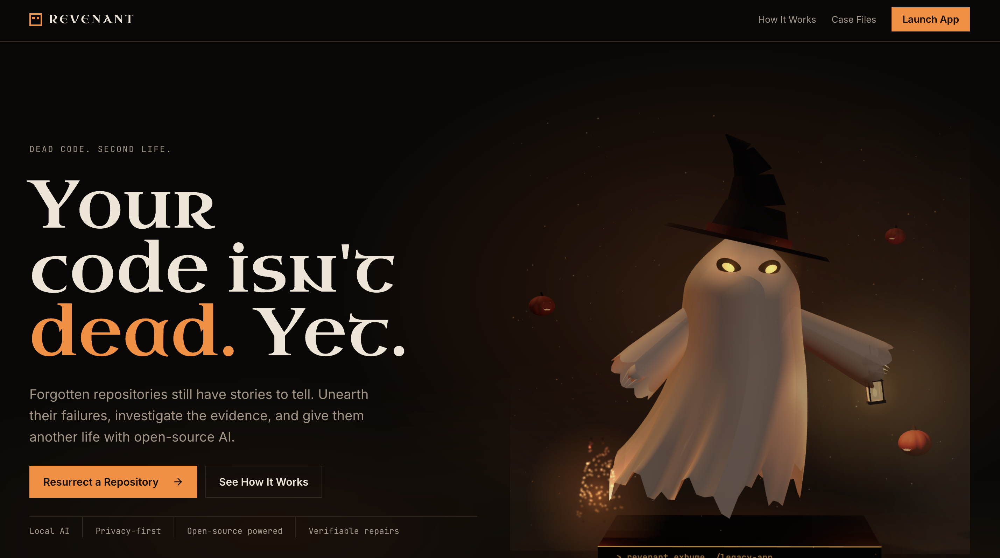

# Revenant

**Dead code. Second life.**

Revenant is a local-first web app that investigates a broken Node.js project, proposes one small AI-written fix, and proves whether it worked by running the project's own checks in a sandbox. Everything runs on your machine: a local model through Ollama and a locked-down Docker container. Your code never leaves your computer.



## The idea

AI tools often say "fixed!" without checking. Revenant never takes the AI's word for it.

- The AI **suggests**: it summarizes the project, diagnoses the failure and writes a patch.
- You **decide**: nothing changes until you approve the patch.
- The sandbox **proves**: the failing check runs before and after the fix. The verdict is computed by plain code from those real results, not by the model.

If the fix doesn't make the check pass, you get an honest **Failed**. If there is nothing wrong, you get **No failure found**. A project is marked **Resurrected** only when its previously failing check passes.

## How it works

1. **Import** a project: a folder, a zip, or one of the bundled samples.
2. **Investigate**: the local model writes an overview, citing files. Claims that don't check out are dropped in code.
3. **Run the check** (with your consent): the project's `npm test` runs in a sandbox and the real error is shown.
4. **Autopsy**: a finding labelled by evidence (*Confirmed by Check*, *Supported by Files*, *Hypothesis*), with labels set by code rather than model confidence.
5. **Propose a repair**: one patch (at most 3 files and 5 edits), shown as a side-by-side diff.
6. **Approve** it. A separate working copy is built; your original stays read-only.
7. **Verify**: the check runs on the original and the patched copy.
8. **Report**: verdict (Resurrected, Partially repaired, Failed or Unverified), before/after evidence, the diff, and which steps the AI did versus plain code.

## Safety

- Binds to `127.0.0.1` only, behind a single-use launch link and a signed session cookie.
- Project code runs only after you tick a consent box, and the tick resets after every run.
- Sandbox: `--network none`, read-only filesystem, all capabilities dropped, memory, CPU and process limits, a timeout, and no image downloads at run time.
- The project is run from a throwaway copy, never from your original files.
- The AI can only suggest. It cannot write a verdict.

See the security notes below before hosting it anywhere.

## Requirements

- Node.js 26 (the scripts use built-in TypeScript support)
- [Docker Desktop](https://www.docker.com/products/docker-desktop/) (running)
- [Ollama](https://ollama.com) (running)
- About 3 GB of free disk space for the model and image, and ideally 8 GB of RAM or more

## Setup

```bash
git clone https://github.com/<your-username>/revenant.git
cd revenant
npm install

# one-time downloads (need internet; everything after this works offline)
ollama pull qwen2.5-coder:3b
docker pull node:lts-slim

cp .env.example .env.local     # the default model is already qwen2.5-coder:3b
npm run prepare-samples        # installs the sample projects' dependencies
npm run setup-check            # should end with "Setup is complete"

npm run build
npm run revenant               # starts the server and opens a one-time unlock link
```

The unlock link works once. If you close the tab, stop the server and run `npm run revenant` again.

## Try it

The app includes four small sample projects (see [samples/README.md](samples/README.md)):

| Sample | What happens |
|---|---|
| `broken-missing-main` | `package.json` points at a file that was renamed. The simplest case, and the one the model most often repairs. |
| `broken-esm` | `require()` of an ESM-only dependency. Usually diagnosed correctly, but the model's patch often doesn't fix it. |
| `broken-removed-api` | Calls a function that a dependency removed. |
| `control-working` | Already works. Revenant should report **No failure found**. |

A step-by-step demo script is in [DEMO.md](DEMO.md).

## How well does it work?

Honest numbers from `npm run eval` with the default model (`qwen2.5-coder:3b`), 3 runs per broken sample (9 runs) plus 3 control runs:

| Measure | Result |
|---|---|
| Failure identified (category and file) | 3 of 9 |
| Verified repair (failing check passes after an approved patch) | 2 of 9 |
| Control project reported healthy | 3 of 3 |
| False "Resurrected" | 0 |

A 3B model is small. It reliably repairs only the simplest sample, and the prompt was tuned on these same samples, so treat the results as in-sample. A larger model should do better but needs more memory. The result that matters most holds: **it never claimed a fix that wasn't verified.** Reproduce with `npm run eval -- --consent`.

AI suggestions are not guaranteed repairs. That's the reason verification exists.

## Development

```bash
npm run dev          # dev server on 127.0.0.1 (copy .env.example to .env.local and fill the two secrets)
npm test             # unit and integration tests (some use real Docker and Ollama and skip if unavailable)
npm run typecheck
npm run lint
```

Stack: Next.js (App Router), React, TypeScript, Tailwind CSS, SQLite (better-sqlite3 and Drizzle), Zod, Vitest, Ollama, Docker.

## Limitations

- Supports one project type: small JavaScript/Node.js projects with an `npm test`, `build` or `start` script.
- It makes narrow repairs, not refactors or migrations. A passing check is not a security audit.
- Not yet verified: a full click-through in a real browser, and an offline run with the network disconnected.

## Security note: don't host this publicly

Revenant is built to run on one person's machine. It runs untrusted project code, has no user accounts, can import folders from the host's disk, and assumes `127.0.0.1` over plain HTTP. Putting it on a public server would let strangers run code on it. Run it locally.

## License

[MIT](LICENSE)
